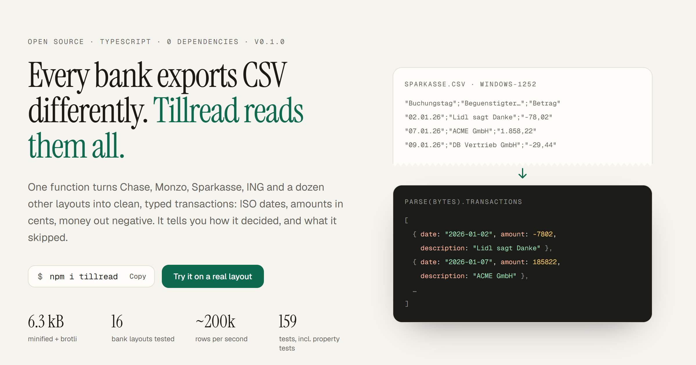
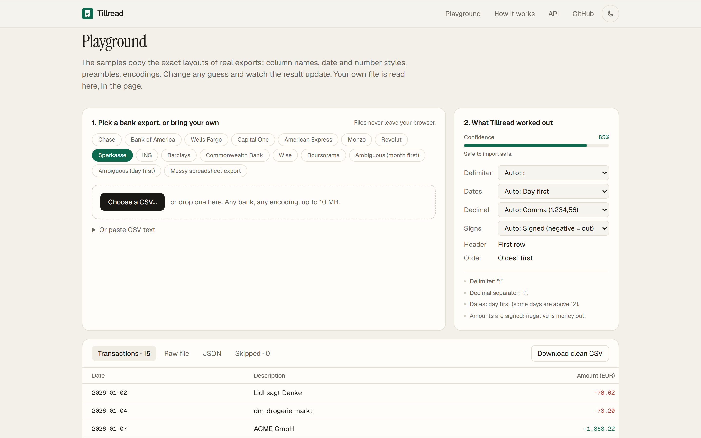
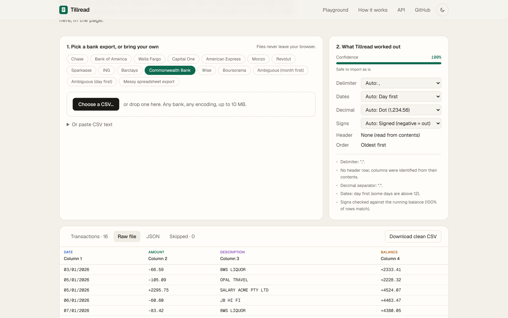
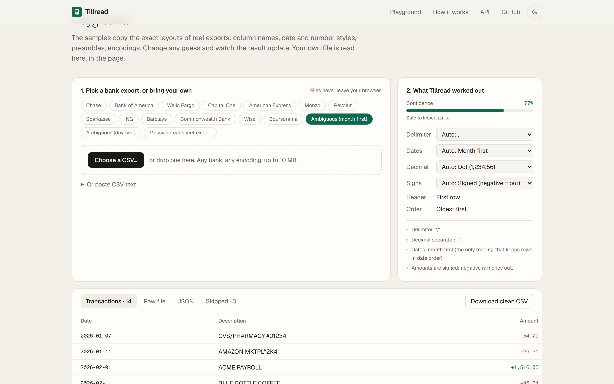
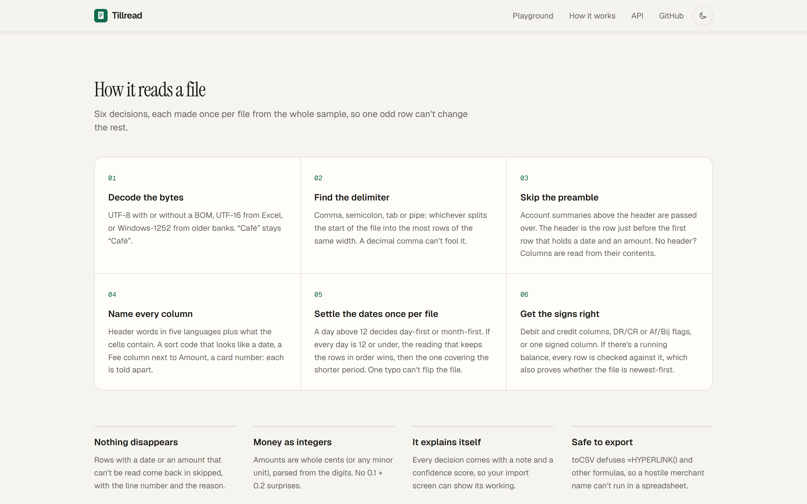
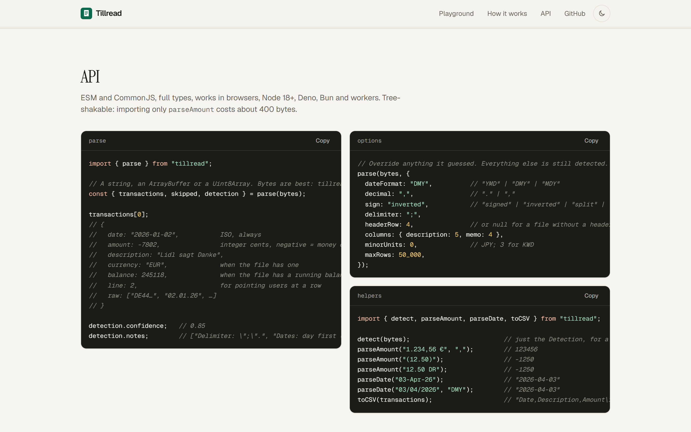
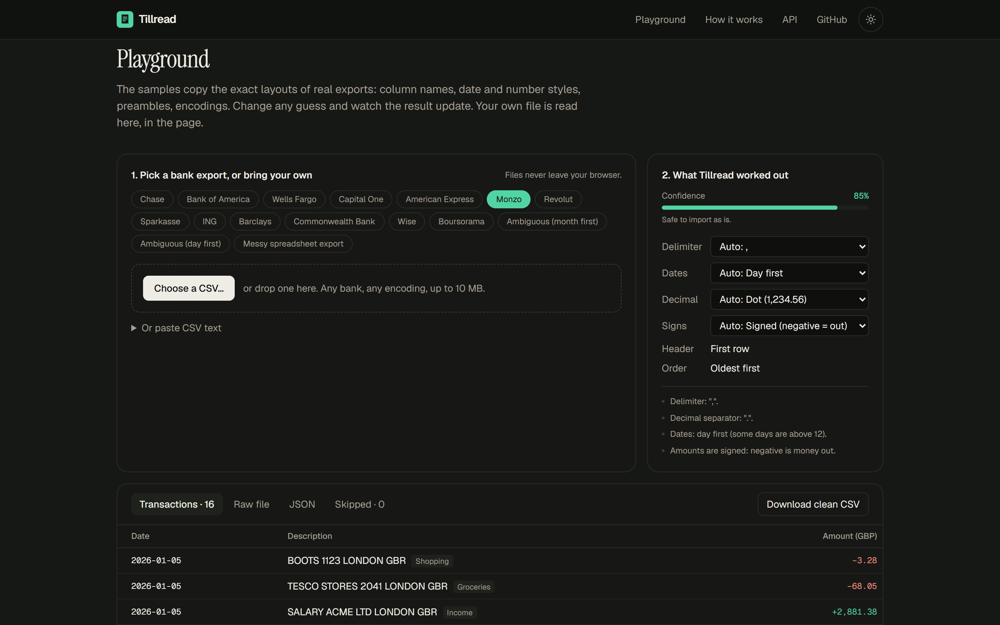
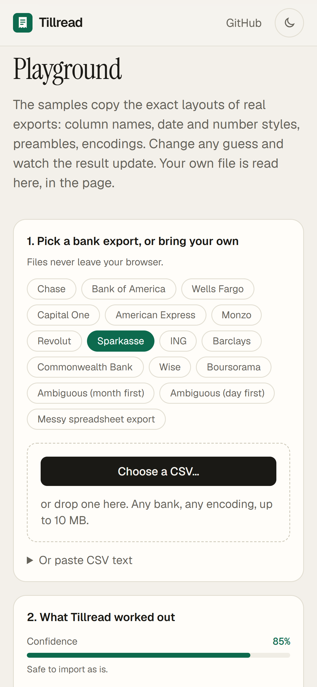

# Tillread: read any bank's CSV
n[](https://github.com/shervs336/tillread/actions/workflows/ci.yml)

**Docs and playground:** https://tillread.vercel.app · **npm:** [`tillread`](https://www.npmjs.com/package/tillread)

An open-source, zero-dependency TypeScript library that turns CSV exports from any bank into clean, typed transactions. It works out the delimiter, encoding, header row, columns, date order, decimal separator and sign convention from the file itself, explains every decision, and returns the rows it couldn't read instead of dropping them.

It grew out of the CSV import in my [Sumwell dashboard](https://sumwell-finance-dashboard.vercel.app), where every new bank broke a hand-written rule.



```ts
import { parse } from "tillread";

const { transactions, skipped, detection } = parse(new Uint8Array(await file.arrayBuffer()));
// transactions: [{ date: "2026-01-02", amount: -7802, description: "Lidl sagt Danke", currency: "EUR", line: 2, raw: [...] }, ...]
```

The package's own README, with the full API, is in [`packages/tillread`](packages/tillread/README.md). The case study is in [`docs/case-study.md`](docs/case-study.md).

## Screenshots

| Playground | Columns by role | Ambiguous dates |
|---|---|---|
|  |  |  |

| How it works | API | Dark mode | Phone |
|---|---|---|---|
|  |  |  |  |

## What it handles

- **Encodings:** UTF-8 with or without a BOM, UTF-16 LE/BE (Excel's "Unicode text"), Windows-1252.
- **Delimiters:** comma, semicolon, tab, pipe. A decimal comma can't fool the detection.
- **Preambles and headers:** account summaries above the header are skipped; files with no header at all are read from their contents.
- **Columns:** header words in five languages plus content checks, so a sort code that looks like a date, a `Fee` next to `Amount`, or a card-number column aren't mistaken for the real thing.
- **Dates:** ISO, `YYYYMMDD`, day-first, month-first, two-digit years, month names in five languages, timestamps. Decided once per file, including files where every day is 12 or under.
- **Amounts:** `-12.50`, `12.50-`, `(12.50)`, `12.50 DR`, `$1,234.56`, `1.234,56 €`, `1 234,56`, `1'234.50`, Unicode minus. Parsed from the digits into integer minor units.
- **Signs:** signed, inverted (card statements), separate debit/credit columns, or a direction column (`DR`/`CR`, `Af`/`Bij`). A running balance is used to prove the signs and the row order.
- **Export:** `toCSV` writes a clean file and defuses spreadsheet formulas (CSV injection).

## Built with

TypeScript (strict, `noUncheckedIndexedAccess`) · esbuild + `tsc` for ESM, CommonJS and per-format type declarations · Vitest + fast-check · size-limit · publint + Are the Types Wrong · Changesets · GitHub Actions · Next.js 16 and Tailwind CSS v4 for the docs site.

## Decisions worth noting

- **Fixtures written from the truth.** A seeded script writes each bank-layout fixture from a known list of transactions, and the tests compare Tillread's output to that list. Testing against snapshots of its own output would only prove it's consistent, not correct.
- **Whole-file decisions.** Delimiter, date order, decimal separator and sign convention are decided once from a sample of rows, so one odd row can't flip the rest.
- **The running balance as an oracle.** When a file has a balance column, each step should equal that row's amount. Checking this settles the sign convention and the row order at the same time.
- **Integers for money.** Amounts are built from the digit strings, never from `parseFloat(x) * 100`, so `0.29` is always `29`.
- **Explain, don't just guess.** `detection.notes`, `warnings` and `confidence` exist so an import screen can show its working and ask the user only when it's unsure.
- **Fast enough not to think about.** A slice-based tokenizer and a fast path for plain amounts took a 1,000-row file from 70 ms to about 11 ms, and run at about 200,000 rows a second.

## Testing

- **159 unit tests** (`npm test`):
  - 16 bank-layout fixtures × 4 checks each: detection, every transaction exact, skipped rows, confidence
  - property-based tests (fast-check):
    - CSV write/read round-trips for random tables, with every delimiter
    - amount round-trips in US and European formats
    - date round-trips in every numeric style from 1971 to 2099
  - edge cases for amounts, dates, encodings and overrides
  - a 100,000-row speed test
- **Coverage:** 97% of lines, 89% of branches.
- **Package checks:** publint and Are the Types Wrong pass for ESM, CommonJS and bundlers. size-limit budget: 7 kB, currently 6.3 kB (brotli).
- **Browser tests for the playground, 17 of 17 passing:**
  - every sample gives the expected count
  - overrides, a UTF-16 upload, pasting and the clean-CSV download
  - theme, 360 px layout and no console errors
- **CI:** Node 20, 22 and 24 on every push.

## Lighthouse (docs site)

| | Performance | Accessibility | Best Practices | SEO |
|---|---|---|---|---|
| Desktop | 99–100 | 100 | 100 | 100 |
| Mobile | 79–97 | 100 | 100 | 100 |

Mobile performance varies between runs on the same build; what remains is mostly React starting up (the playground itself loads only when you scroll near it).

## Run it

```bash
npm install
npm test            # library tests
npm run dev         # builds the library, then the docs site at http://localhost:3000
npm run check       # typecheck, test, build, size budget, package lint
```

## Releasing

Run `npx changeset`, describe the change, and merge to `main`. The release workflow opens a "Version packages" pull request; merging that publishes to npm with provenance.

## Project structure

```
packages/tillread/
  src/          decode, csv (tokenizer), amount, date, detect, parse, export
  test/         unit + property tests; fixtures/ (16 bank layouts + expected.json)
  scripts/      build (esbuild + tsc), make-fixtures, bench
src/            docs site (Next.js): page, playground, code blocks
docs/           case study, screenshots, thumbnail
```

## What I learned

- **Test against the truth, not against yourself.** Writing fixtures from known transactions caught mistakes that snapshot tests would have frozen in place.
- **Ambiguity needs a strategy, not a default.** Row order and date span resolve most "is 03/04 March or April?" files that a fixed rule gets wrong.
- **Publishing a dual ESM/CommonJS package is its own skill.** The types have to resolve per format, and Are the Types Wrong is the quickest way to know they do.
- **Small libraries still need profiling.** The first tokenizer built strings one character at a time; switching to slices made it several times faster.

_Edit these in your own words before sharing._
