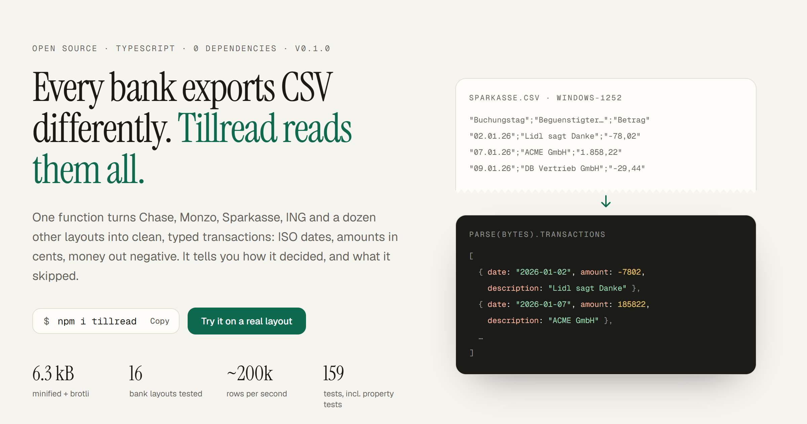
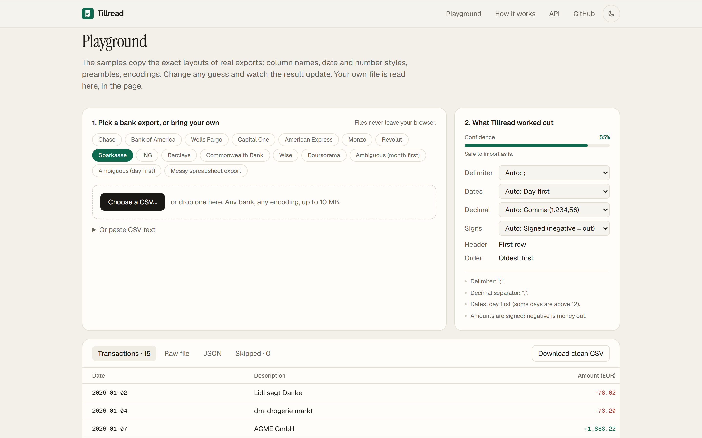
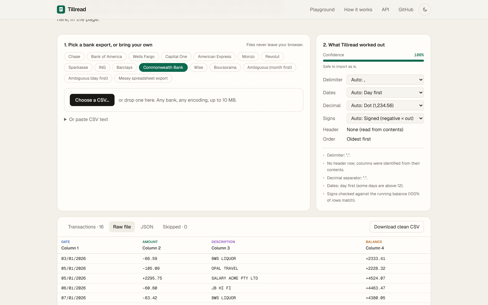
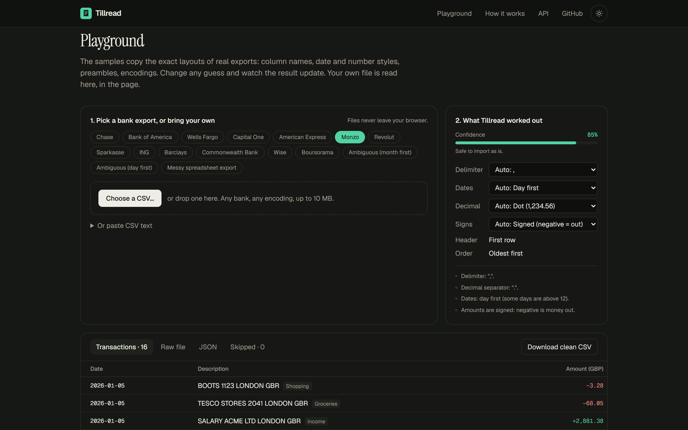
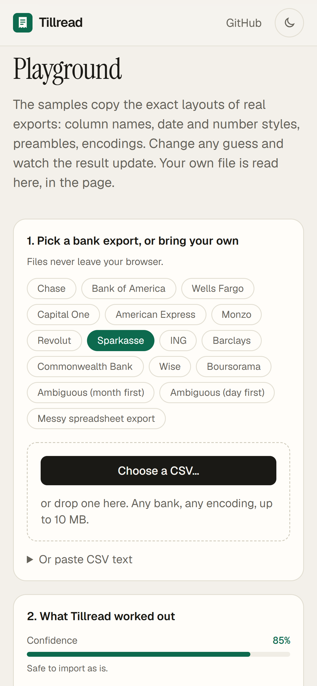

# Tillread: case study

**Role:** Design and development (solo)
**Type:** Open-source TypeScript library + docs site with a live playground
**Stack:** TypeScript, esbuild, Vitest, fast-check, size-limit, publint, Are the Types Wrong, Changesets, GitHub Actions, Next.js 16, Tailwind CSS v4, Vercel
**Links:** [Docs and playground](https://tillread.vercel.app) · [Code](https://github.com/shervs336/tillread) · [npm](https://www.npmjs.com/package/tillread)

---

## Short version (for a portfolio card)

> A zero-dependency library that reads CSV exports from any bank: it detects the delimiter, encoding, header, columns, date order, decimal separator and sign convention, and returns ISO dates and integer cents. It's tested against 16 bank layouts and runs at about 200,000 rows a second, with a playground that shows how it decided.

---

## Problem

Every personal-finance app eventually needs "import from your bank", and every bank's CSV is different:
- Chase adds a trailing comma, and Bank of America puts five lines of summary above the header.
- Wells Fargo has no header at all.
- Sparkasse uses semicolons, `1.234,56` and Windows-1252.
- ING has unsigned amounts with an `Af`/`Bij` column.
- American Express writes charges as positive numbers.

When I built the CSV import for Sumwell, each new bank meant a new special case. Existing CSV libraries tokenize well but stop there: they don't know what a bank statement means.

The goal: one function that gets these right without per-bank configuration, explains itself, and never silently loses a row.

## Approach

- **Separate tokenizing from understanding.** An RFC 4180 tokenizer produces rows. Detection then looks at a sample of them to decide the layout, and parsing applies those decisions to every row.
- **Decide once per file.** Delimiter, date order, decimal separator and sign convention come from the whole sample, so a single odd row can't flip the result.
- **Combine header words with content.** Header patterns in five languages are weighed together with what the cells hold: dates, amounts, currency codes, direction flags, long text.
- **Make uncertainty visible.** Every decision adds a note. Ambiguous cases add a warning. A confidence score tells an app when to ask the user.
- **Show it.** The docs site has a playground with 16 sample layouts and a file drop. It shows the detection, lets you override each guess, and labels the raw columns by role.

## Key decisions

| Decision | Why |
|---|---|
| Fixtures generated from a known list of transactions | Tests compare against the truth, not against the library's own earlier output. |
| Running balance as a check | When a balance column exists, each step must equal the amount. That proves the signs and the row order at once. |
| Row order, then date span, for ambiguous dates | When every day is 12 or under, only one reading usually keeps the rows sorted or covers a plausible period. |
| Integer minor units built from digit strings | No floating-point rounding, and currencies without cents (JPY) or with three decimals (KWD) work. |
| Rows that can't be read go to `skipped` | An importer must be able to tell the user "line 8 has no amount", not lose it. |
| esbuild + `tsc` for the build, with separate `.d.ts`/`.d.cts` | Correct types for ESM and CommonJS consumers, verified by Are the Types Wrong. |
| Playground loads when scrolled near | The parser and the playground no longer run at page load. Mobile total blocking time dropped from 1.2 s to 0.2–0.9 s. |

## Challenges

- **Ambiguous dates.** A file of dates such as `01/10`, `01/12`, `02/03` reads as valid either way. Voting finds nothing, but reading it day-first jumps between months out of order. The order check, then the span check, settles it. A warning is raised only when neither does.
- **Look-alike columns.** Barclays' sort code `20-32-06` matches a date pattern. Monzo has `Amount`, `Local amount`, `Money Out` and `Money In`. Wise has `Description`, `Merchant` and `Payee Name`. Each needed both a header rule and a content rule.
- **Sign conventions.** Card statements write charges as positive numbers. Without a balance or a direction column, Tillread looks at rows that are clearly money in: payments, refunds and salary show which sign means income.
- **Speed.** The first tokenizer built strings one character at a time. Moving to slices, and adding a fast path for plain amounts, took a 1,000-row file from 70 ms to about 11 ms.
- **Local tooling.** The newest bundler's native binary was blocked by Windows Smart App Control. Building with esbuild plus the TypeScript compiler avoided weakening that protection. It also produced simpler, easier-to-audit output.

## Testing

- **159 unit tests,** including:
  - 16 bank layouts, each checked for detection, every transaction, skipped rows and confidence
  - property-based round-trips for CSV, amounts and dates
- **Coverage:** 97% of lines, 89% of branches.
- **Package checks:** publint and Are the Types Wrong pass; the size budget is enforced in CI (6.3 kB brotli).
- **17 browser tests for the playground,** all passing:
  - all 16 samples
  - overrides, a UTF-16 upload, pasted text, the clean-CSV download
  - dark mode, the 360 px layout and console errors
- **CI** runs the library on Node 20, 22 and 24.

## Result

- A published-ready library with a clean API, full types and a release pipeline (Changesets, npm provenance).
- About 200,000 rows a second, 6.3 kB, zero dependencies.
- **Lighthouse (docs site):** desktop 99–100 / 100 / 100 / 100; mobile 79–97 / 100 / 100 / 100 (it varies between runs; most of what remains is React starting up).

| Dark mode | Phone |
|---|---|
|  |  |

## What I'd do next

- An OFX/QFX reader with the same `Transaction` shape.
- Learned layouts: remember the user's corrections for a file fingerprint.
- A merchant-name cleaner (`AMAZON MKTPL*2K4` → `Amazon`) as a separate, optional package.
